  

<h1 align="center">
  
</h1>

---

<h2 align="center">About Me</h2>

<table>
  <tr>
    <td width="40%" align="center">
      
    </td>
    <td width="60%" valign="middle">
      <h3>👋 Hi, I'm Pereira!</h3>
      
Software Developer passionate about technology, focused on building creative and efficient solutions.

      
I love learning new tools, contributing to open-source projects, and turning ideas into code.

    </td>
  </tr>
</table>

---

<h2 align="center">My Personal Stack</h2>

  

---

<h2 align="center">GitHub Stats</h2>

  
  
  

---

<h2 align="center">My Top Repositories</h2>

  
  
  

---

  <picture data-importer="pacman">
    <source media="(prefers-color-scheme: dark)" srcset="https://raw.githubusercontent.com/wxypereira/wxypereira/pacman-output/pacman-contribution-graph-dark.svg?game=pacman" />
    <source media="(prefers-color-scheme: light)" srcset="https://raw.githubusercontent.com/wxypereira/wxypereira/pacman-output/pacman-contribution-graph.svg?game=pacman" />
    
  </picture>

---

  
  
  

